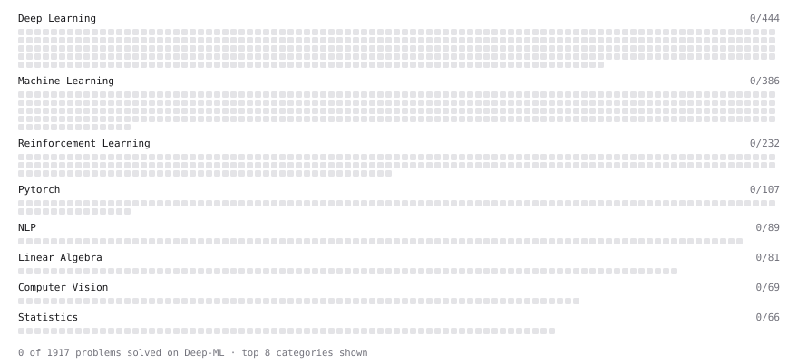

# Deep-ML

My machine learning practice from [Deep-ML](https://www.deep-ml.com). Every solution here was written by hand.

**1** solved · 0 problems · 0 labs · 1 math

[**Browse the interactive portfolio**](https://devam1402.github.io/deep-ml/) to replay this filling in over time.

## Math

| | Difficulty | Solved | |
| --- | --- | --- | --- |
| [The GPU Memory Hierarchy and the Decode Latency Floor](https://www.deep-ml.com/math-problems/172) | medium | 2026-11-05 | [solution](math/0172-the-gpu-memory-hierarchy-and-the-decode-latency-floor) |

---

_This file is regenerated by Deep-ML on every push._
